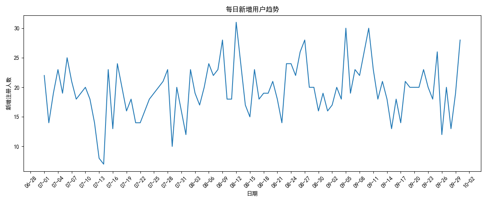
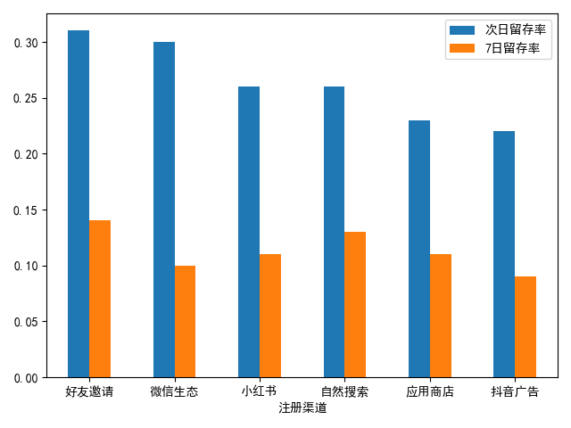
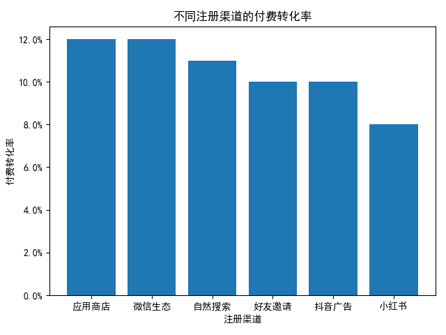
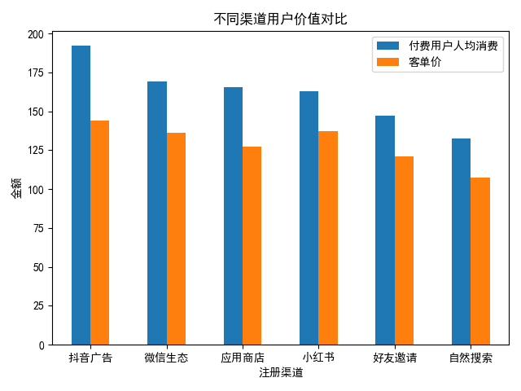

# 用户增长与留存分析

这是一个面向数据分析岗位作品集的个人项目，使用 Python、Pandas、MySQL 和 Matplotlib，围绕电商用户从注册到复购的关键路径展开分析：

> 用户拉新 → 用户留存 → 付费转化 → 用户价值 → 复购

**本项目使用模拟业务数据，仅用于个人数据分析学习与作品展示，不代表任何真实企业经营数据。**

## 项目背景与分析目标

项目以模拟电商业务数据为基础，希望回答以下问题：

1. 用户增长趋势如何，不同渠道带来的用户规模有何差异？
2. 不同渠道用户在注册后第 1 天和第 7 天的留存表现如何？
3. 各渠道截至数据截止日的累计付费转化率如何？
4. 完成付费后，各渠道用户的消费金额、客单价与复购表现有何差异？

分析不以单一指标评价渠道，而是依次观察用户规模、留存、付费转化、付费后消费价值和复购。

## 数据说明

数据观察期为 2025-07-01 至 2025-09-30，原始工作簿包含以下主要数据表：

| 数据表 | 记录数 | 说明 |
| --- | ---: | --- |
| `users` | 1,800 | 用户注册日期、注册渠道及基础属性 |
| `login` | 8,958 | 用户登录时间及会话行为 |
| `orders` | 250 | 订单金额、支付方式及订单状态 |
| `products` | 72 | 商品品类、价格、成本及状态 |

工作簿内还包含 `summary` 和 `data_dictionary` 工作表，用于说明数据概况与字段含义。完整模拟数据位于 [`data/user_growth_data.xlsx`](data/user_growth_data.xlsx)。

## 技术栈

- Python、Pandas：数据读取、质量检查与指标计算
- MySQL：数据检查及业务分析查询
- Matplotlib：核心指标可视化
- Excel：模拟数据文件与数据字典

## 数据质量检查

使用 Pandas 和 SQL 对四张业务表执行了以下检查：

- 缺失值与完全重复记录
- 用户 ID、登录 ID、订单 ID、商品 ID 的主键唯一性
- 订单用户、登录用户与注册用户的关联完整性
- 订单商品与商品表的关联完整性
- 注册前下单、注册前登录等时间逻辑异常

当前数据中上述检查均未发现异常，可进入业务分析阶段。数据质量检查代码见 [`src/analysis.py`](src/analysis.py)；在 MySQL Workbench 中实际使用并整理后的业务分析查询见 [`sql/analysis.sql`](sql/analysis.sql)。

## 指标定义与业务口径

| 指标 | 定义 |
| --- | --- |
| 有效付费订单 | 订单状态为“已完成”；已取消和已退款订单不计入 |
| 付费用户 | 至少有 1 笔已完成订单的注册用户 |
| 次日留存 | 用户在注册后第 1 天当天至少登录 1 次，同一天多次登录只计 1 人 |
| 7 日留存 | 用户在注册后第 7 天当天至少登录 1 次，不是“注册后 7 天内回来过” |
| 累计付费转化率 | 付费用户数 ÷ 注册用户数 |
| 客单价（AOV） | 已完成订单总实付金额 ÷ 已完成订单数 |
| 付费用户人均消费 | 已完成订单总实付金额 ÷ 付费用户数 |
| 复购用户 | 至少有 2 笔已完成订单的付费用户 |
| 复购率 | 复购用户数 ÷ 付费用户数 |

登录数据的最大时间为 2025-09-30 22:54:51，因此次日留存的完整观察窗口要求注册日期不晚于 2025-09-29，7 日留存要求注册日期不晚于 2025-09-23。为了在同一张表和图中直接比较两个指标，本项目统一使用 **注册日期不晚于 2025-09-23** 的 cohort，避免把观察窗口不足的用户错误地视为未留存。

代表性的留存 SQL：

```sql
COUNT(DISTINCT CASE
    WHEN DATEDIFF(l.登录时间, u.注册日期) = 1 THEN u.用户ID
END) / COUNT(DISTINCT u.用户ID) AS 次日留存率
```

付费转化查询使用 `LEFT JOIN`，将没有已完成订单的注册用户保留在分母中：

```sql
FROM users u
LEFT JOIN orders o
  ON u.用户ID = o.用户ID
 AND o.订单状态 = '已完成'
```

## 分析结果

### 1. 用户增长

自然搜索带来 419 名注册用户，抖音广告带来 393 名注册用户，是注册规模较大的两个渠道。每日新增用户存在波动，后续在实际业务中应结合投放日期、活动安排和渠道成本继续解释异常日期，而不能仅凭注册量判断渠道质量。



### 2. 用户留存

以下结果使用统一 cohort（注册日期不晚于 2025-09-23）：

| 注册渠道 | 次日留存率 | 7 日留存率 |
| --- | ---: | ---: |
| 好友邀请 | 31% | 14% |
| 微信生态 | 30% | 10% |
| 小红书 | 26% | 11% |
| 自然搜索 | 26% | 13% |
| 应用商店 | 23% | 11% |
| 抖音广告 | 22% | 9% |

好友邀请的次日和 7 日留存率相对较高；抖音广告在两个留存指标上相对较低。这些差异用于描述当前样本中的渠道表现，不代表渠道本身对留存产生了因果影响。



### 3. 付费转化

累计付费转化率统计截至数据截止日，每个付费用户至少有 1 笔已完成订单。

| 注册渠道 | 注册用户数 | 付费用户数 | 累计付费转化率 |
| --- | ---: | ---: | ---: |
| 应用商店 | 251 | 30 | 12% |
| 微信生态 | 306 | 37 | 12% |
| 自然搜索 | 419 | 47 | 11% |
| 好友邀请 | 241 | 23 | 10% |
| 抖音广告 | 393 | 39 | 10% |
| 小红书 | 190 | 16 | 8% |



### 4. 用户价值

全部 242 笔已完成订单的总实付金额为 30,948.62，覆盖 192 名付费用户。整体客单价为 127.89，付费用户人均消费为 161.19。

| 注册渠道 | 付费用户数 | 已完成订单数 | 总实付金额 | 付费用户人均消费 | 客单价 |
| --- | ---: | ---: | ---: | ---: | ---: |
| 微信生态 | 37 | 46 | 6,270.07 | 169.46 | 136.31 |
| 应用商店 | 30 | 39 | 4,960.66 | 165.36 | 127.20 |
| 自然搜索 | 47 | 58 | 6,228.01 | 132.51 | 107.38 |
| 抖音广告 | 39 | 52 | 7,501.28 | 192.34 | 144.26 |
| 好友邀请 | 23 | 28 | 3,383.28 | 147.10 | 120.83 |
| 小红书 | 16 | 19 | 2,605.32 | 162.83 | 137.12 |



### 5. 复购

复购使用两层聚合：先统计每位付费用户的已完成订单数，再按渠道统计至少有 2 笔已完成订单的用户数。

| 注册渠道 | 付费用户数 | 复购用户数 | 复购率 |
| --- | ---: | ---: | ---: |
| 应用商店 | 30 | 8 | 27% |
| 抖音广告 | 39 | 10 | 26% |
| 好友邀请 | 23 | 5 | 22% |
| 微信生态 | 37 | 8 | 22% |
| 自然搜索 | 47 | 10 | 21% |
| 小红书 | 16 | 3 | 19% |

## 核心业务发现

### 抖音广告：付费前指标偏低，付费后价值较高

抖音广告的注册规模较大，但统一 cohort 下次日留存率为 22%、7 日留存率为 9%，累计付费转化率为 10%，相对偏低。与此同时，其付费用户人均消费为 192.34、客单价为 144.26、复购率为 26%，在已付费用户中表现较高。

因此，更值得继续调查的是抖音广告用户从注册到留存、付费的环节；当前结果不能证明提高留存一定会提高收入，也不能直接推导预算调整结论。

### 自然搜索：规模和前链路相对稳定，付费后金额偏低

自然搜索带来 419 名注册用户，统一 cohort 下次日留存率为 26%、7 日留存率为 13%，累计付费转化率为 11%。其付费用户人均消费为 132.51、客单价为 107.38，相对较低。

后续可以进一步拆解自然搜索用户购买的商品品类、价格区间和购买数量。这里不将金额差异简单解释为“用户质量差”。

### 需要同时关注样本量

小红书只有 16 名付费用户。渠道百分比应与绝对人数一起阅读，避免根据小样本比例作出过强结论。

## 项目局限性

1. 数据为模拟业务数据，不是真实企业数据。
2. 订单样本量只有 250 条，部分渠道付费用户数量较少，指标可能受到随机波动影响。
3. 当前累计付费转化率没有统一“注册后 X 天”的观察窗口，不同注册日期用户的累计观察时长可能不同。
4. 数据中没有渠道广告成本、CAC、ROI 等信息，不能直接给出渠道预算增加或减少的结论。
5. 当前分析主要属于描述性分析，渠道指标之间的关系不能直接解释为因果关系。

## 后续分析方向

- 在统一注册后观察窗口下重新比较渠道付费转化，降低注册日期差异带来的影响。
- 拆解自然搜索用户的商品品类、价格区间和购买数量，解释付费后金额差异。
- 对抖音广告用户进一步分析注册后关键行为路径，定位留存与付费环节的流失位置。
- 在获得渠道成本后补充 CAC、ROI 和回收周期分析，再讨论投放效率。
- 扩大订单样本并按注册周持续跟踪，观察渠道差异是否稳定。

## 项目结构

```text
user-growth-analysis/
├── README.md
├── requirements.txt
├── .gitignore
├── .env.example
├── data/
│   └── user_growth_data.xlsx
├── sql/
│   └── analysis.sql
├── src/
│   └── analysis.py
└── images/
    ├── daily_users.png
    ├── retention.png
    ├── conversion.png
    └── user_value.png
```

## 运行方式

安装依赖：

```bash
pip install -r requirements.txt
```

直接使用项目内 Excel 数据运行：

```bash
python src/analysis.py
```

如需从 MySQL 读取数据，先复制 `.env.example` 为 `.env`，填写本地配置，并将变量加载到当前终端环境。`.env` 已被 `.gitignore` 忽略，请勿提交真实密码。随后运行：

```bash
python src/analysis.py --source mysql
```

数据库中应存在 `users`、`login`、`orders`、`products` 四张与工作簿字段一致的表。
